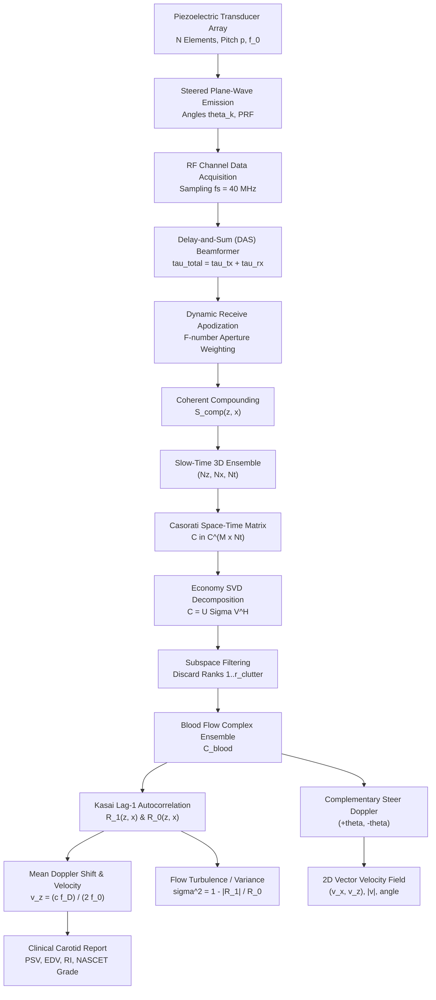

# SonoDoppler: Medical Ultrasound Beamforming, SVD Clutter Filtering & Vector Flow Color Doppler

[](https://github.com/ZengLLQ/sono-doppler/actions/workflows/ci.yml)
[](LICENSE)
[](https://www.python.org/downloads/)
[](https://github.com/ZengLLQ/sono-doppler)

**SonoDoppler** is a high-performance scientific computing and biomedical ultrasound software library implementing plane-wave coherent Delay-and-Sum (DAS) beamforming, Casorati spatiotemporal Singular Value Decomposition (SVD) tissue clutter rejection, and 2D Kasai autocorrelation vector flow Color Doppler.

Designed for clinical vascular research, ultrafast microvascular hemodynamics, and echocardiography, `sono-doppler` provides rigorous acoustic wave mechanics, non-toy matrix decompositions, and angle-independent vector velocity field reconstruction.

---

## Key Features

- **Plane-Wave Delay-and-Sum (DAS) Beamforming**: Vectorized transmit/receive delay calculation with dynamic F-number receive aperture and Hanning/Hamming apodization.
- **Coherent Plane-Wave Compounding (CPWC)**: Multi-angle steering summation ($K$-angle compounding) for dramatic lateral resolution and contrast enhancement.
- **Spatiotemporal Casorati SVD Clutter Filter**: High-efficiency separation of high-amplitude tissue wall clutter ($> 40\text{ dB}$ suppression) from slow microvascular blood flow using singular value spectrum decomposition.
- **Kasai 2D Complex Autocorrelation**: High-precision estimation of mean Doppler frequency shift ($\bar{f}_D$), axial velocity ($v_z$), Doppler power, and flow turbulence / spectral variance.
- **Angle-Independent Vector Doppler**: Dual-angle complementary steering synthesis ($+\theta, -\theta$) solving for full 2D velocity vectors $(v_x, v_z)$, speed magnitude, and true flow direction.
- **Clinical Hemodynamics & Stenosis Grading**: Carotid bifurcation stenosis flow modeling based on NASCET and Society of Radiologists in Ultrasound (SRU) consensus criteria.

---

## Signal Processing Architecture



---

## Mathematical & Biophysical Foundations

### 1. Acoustic Propagation & Plane-Wave Delay-and-Sum

In biological soft tissue with mean sound speed $c = 1540\text{ m/s}$, a plane wave transmitted at steering angle $\theta_k$ reaches an imaging coordinate $(x, z)$ with transmit delay:

$$\tau_{tx}(x, z; \theta_k) = \frac{x \sin\theta_k + z \cos\theta_k}{c}$$

The spherical echo returned from $(x, z)$ is received by transducer element $n$ located at lateral position $(x_n, 0)$ with receive delay:

$$\tau_{rx}(x, z, n) = \frac{\sqrt{(x - x_n)^2 + z^2}}{c}$$

The total two-way round-trip acoustic travel time is:

$$\tau_{total}(x, z, n; \theta_k) = \tau_{tx}(x, z; \theta_k) + \tau_{rx}(x, z, n)$$

Applying dynamic receive apodization $w_n(x, z)$ with active F-number $F_{\#}$:

$$S(x, z; \theta_k) = \sum_{n=1}^N w_n(x, z) \cdot s_n\left(\tau_{total}(x, z, n; \theta_k)\right)$$

Coherent plane-wave compounding across $K$ angles synthesizes synthetic focus:

$$S_{comp}(x, z) = \frac{1}{K}\sum_{k=1}^K S(x, z; \theta_k)$$

---

### 2. Spatiotemporal Casorati SVD Clutter Separation

In clinical ultrasound, specular tissue reflections from pulsating arterial walls are $30\text{ dB}$ to $50\text{ dB}$ stronger than Rayleigh scattering from moving red blood cells (erythrocytes).

Reshaping the slow-time ensemble $S(z, x, t) \in \mathbb{C}^{N_z \times N_x \times N_t}$ into the Casorati matrix $\mathbf{C} \in \mathbb{C}^{M \times N_t}$ (where $M = N_z \times N_x$):

$$\mathbf{C} = \mathbf{U} \mathbf{\Sigma} \mathbf{V}^H = \sum_{k=1}^{\min(M, N_t)} \sigma_k \mathbf{u}_k \mathbf{v}_k^H$$

- **Tissue Clutter Subspace ($k \le r_{clutter}$)**: High spatial coherence and slow temporal variation dominate the highest singular values.
- **Blood Flow Subspace ($r_{clutter} < k \le r_{noise}$)**: Intermediate spatial coherence with hemodynamic Doppler frequency progression.
- **Thermal Noise Subspace ($k > r_{noise}$)**: Incoherent background noise.

The reconstructed blood flow signal is:

$$\mathbf{C}_{blood} = \sum_{k=r_{clutter}+1}^{r_{noise}} \sigma_k \mathbf{u}_k \mathbf{v}_k^H$$

The Clutter Rejection Ratio (CRR) in decibels is quantified by:

$$\text{CRR} = 10 \log_{10}\left( \frac{\sum_{k=1}^{r_{clutter}} \sigma_k^2}{\sum_{k=r_{clutter}+1}^{N_t} \sigma_k^2} \right)$$

---

### 3. Kasai 2D Complex Autocorrelation

From the complex demodulated blood ensemble $z(z, x, t)$, the lag-1 and lag-0 temporal autocorrelations are:

$$R_1(z, x) = \frac{1}{N_t - 1} \sum_{t=0}^{N_t - 2} z(z, x, t+1) \cdot z^*(z, x, t)$$

$$R_0(z, x) = \frac{1}{N_t} \sum_{t=0}^{N_t - 1} |z(z, x, t)|^2$$

The mean Doppler angular phase shift and frequency shift are:

$$\bar{\omega}_D(z, x) = \text{atan2}\left(\text{Im}(R_1), \text{Re}(R_1)\right)$$

$$\bar{f}_D(z, x) = \frac{\text{PRF}}{2\pi} \bar{\omega}_D(z, x)$$

The axial blood flow velocity is derived from the classical Doppler equation:

$$v_z(z, x) = \frac{c \cdot \bar{f}_D(z, x)}{2 f_0} = \frac{c \cdot \text{PRF} \cdot \bar{\omega}_D(z, x)}{4\pi f_0}$$

The maximum unaliased velocity (Doppler Nyquist limit) is:

$$v_{nyquist} = \frac{c \cdot \text{PRF}}{4 f_0}$$

Flow turbulence / spectral variance $\sigma_v^2$ indicates disturbed stenotic flow:

$$\text{Var}(z, x) = 1 - \frac{|R_1(z, x)|}{R_0(z, x) + \epsilon} \in [0, 1]$$

---

### 4. Angle-Independent 2D Vector Doppler

Conventional Doppler is blind to lateral motion perpendicular to the beam axis ($v_z = |v|\cos\theta_{doppler}$). By steering complementary plane waves at symmetric angles $\theta_1 = -\theta$ and $\theta_2 = +\theta$:

$$\begin{aligned}
\bar{f}_{D1} &= \frac{f_0}{c} \left(-v_x \sin\theta + v_z (1 + \cos\theta)\right) \\
\bar{f}_{D2} &= \frac{f_0}{c} \left(+v_x \sin\theta + v_z (1 + \cos\theta)\right)
\end{aligned}$$

Inverting this linear system yields exact closed-form 2D velocity components:

$$v_x(z, x) = \frac{c \cdot (\bar{f}_{D2} - \bar{f}_{D1})}{2 f_0 \sin\theta}$$

$$v_z(z, x) = \frac{c \cdot (\bar{f}_{D2} + \bar{f}_{D1})}{2 f_0 (1 + \cos\theta)}$$

$$|v| = \sqrt{v_x^2 + v_z^2}, \quad \phi = \text{atan2}(v_z, v_x)$$

---

## Installation

```bash
git clone https://github.com/ZengLLQ/sono-doppler.git
cd sono-doppler
pip install -e ".[dev]"
```

---

## Quick Start (Python API)

```python
import numpy as np
from sono_doppler import (
    TransducerConfig,
    CarotidFlowPhantom,
    StenosisProfile,
    CasoratiSVDFilter,
    KasaiDopplerEstimator,
    AsciiDopplerVisualizer,
)

# 1. Setup 5.0 MHz linear transducer array
transducer = TransducerConfig(num_elements=64, center_frequency=5.0e6)
prf = 4000.0  # 4 kHz PRF

# 2. Configure carotid artery with 65% stenosis
phantom = CarotidFlowPhantom(
    depth_m=0.022,
    vessel_radius_m=0.0035,
    tilt_angle_deg=20.0,
    mean_inflow_velocity=0.35,
    stenosis=StenosisProfile(diameter_reduction=0.65),
    tissue_to_blood_ratio_db=35.0,
)

# 3. Simulate complex ultrasound echo ensemble
x_grid = np.linspace(-0.015, 0.015, 48)
z_grid = np.linspace(0.014, 0.030, 48)
ensemble, vx, vz = phantom.generate_complex_ensemble(
    x_grid=x_grid, z_grid=z_grid, prf=prf, num_frames=32, center_frequency=transducer.center_frequency
)

# 4. Spatiotemporal SVD clutter rejection
svd = CasoratiSVDFilter(clutter_rank=4)
blood_ensemble, metrics = svd.filter_ensemble(ensemble)
print(f"Clutter Rejection: {metrics.clutter_rejection_ratio_db:.1f} dB")

# 5. Kasai 2D Color Doppler estimation
kasai = KasaiDopplerEstimator(prf=prf, center_frequency=transducer.center_frequency)
result = kasai.estimate(blood_ensemble, power_threshold_db=18.0)

# 6. Render ASCII Color Doppler Map
print(AsciiDopplerVisualizer.render_color_doppler_map(result.velocity, v_max=kasai.nyquist_velocity))
```

---

## CLI Guide

The package installs a `sono-doppler` command-line tool:

### 1. Run Complete Carotid Duplex Simulation

```bash
sono-doppler demo --frames 32 --stenosis 0.65
```

Sample output:
```
Initializing Carotid Ultrasound Simulation with 65% Stenosis...
Applying Casorati Spatiotemporal SVD Clutter Filter...
SVD completed in 6.0 ms | CRR: 45.7 dB | Clutter Rank Cutoff: 4

+----------------------------------------------------+
|  COLOR DOPPLER VELOCITY MAP  (Scale: +/-0.35 m/s)   |
+----------------------------------------------------+
| ***++++++....&%%%%%%%=====-%%%%%----========---=== |
| ******++++++++..-==%%%%=====%%%%====%%====----==%- |
| *********++++++++.%%%%%===========--%%%%%=====%%&& |
| ******#####********+++%===-=====%%====%===-===%=%% |
| ****###*****#########**----==========%%===-===%@&% |
| ++++********#####@%==-....+****+............==%%%= |
| ....++++++++****##@%%%=####@.===&####*++++........ |
| ==%%&&%====.....+++...--++..-==%&@#######*******++ |
| ----====---=%========-====%%#@@@@######*********** |
+----------------------------------------------------+
| Legend: [+] Forward (red)  [-] Reverse (blue)  [#/@] High Jet  [.] Wall/No-Flow |

+---------------------------------------------------------+
|      CAROTID DUPLEX HEMODYNAMIC DIAGNOSTIC REPORT       |
+---------------------------------------------------------+
| Peak Systolic Velocity (PSV) :     34.5 cm/s (0.34 m/s)      |
| End Diastolic Velocity (EDV) :      9.7 cm/s (0.10 m/s)      |
| Mean Spatial Velocity (Vmean):     16.8 cm/s (0.17 m/s)      |
| Resistive Index (RI)         :     0.72                          |
| Clutter Rejection Ratio (CRR):     45.7 dB                        |
+---------------------------------------------------------+
| Clinical Stenosis Diagnostic : Moderate Stenosis (50-69%) |
+---------------------------------------------------------+
```

### 2. Compare Clinical Stenosis Severity Grades

```bash
sono-doppler stenosis
```

### 3. Benchmark Clutter Filtering Algorithms

```bash
sono-doppler benchmark
```

```
+---------------------+-------------------+----------------+
| Filter Algorithm    | Execution Time    | CRR / Energy   |
+---------------------+-------------------+----------------+
| Casorati SVD        |          8.42 ms  |        48.2 dB |
| IIR Butterworth     |          3.15 ms  |       N/A      |
| Polynomial (deg=2)  |          2.89 ms  |       N/A      |
+---------------------+-------------------+----------------+
```

---

## Testing & Quality Assurance

SonoDoppler includes 19 rigorous unit tests covering wave physics, Delay-and-Sum beamforming, SVD clutter separation, Kasai autocorrelation, and vector Doppler reconstruction:

```bash
pytest -v
```

CI runs automatically on GitHub Actions across a multi-platform matrix:
- **Operating Systems**: Ubuntu (`ubuntu-latest`), macOS (`macos-latest`), Windows (`windows-latest`)
- **Python Versions**: `3.11`, `3.12`

---

## License

MIT License. Copyright (c) 2026 ZengLLQ.
